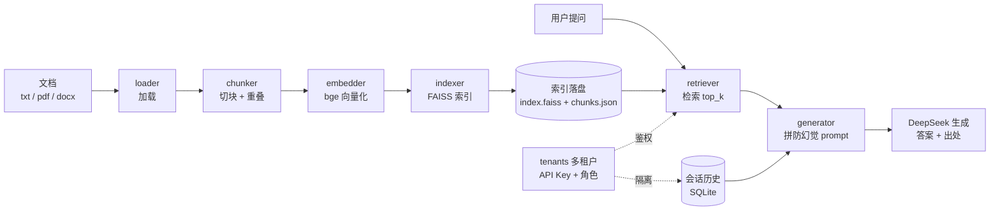
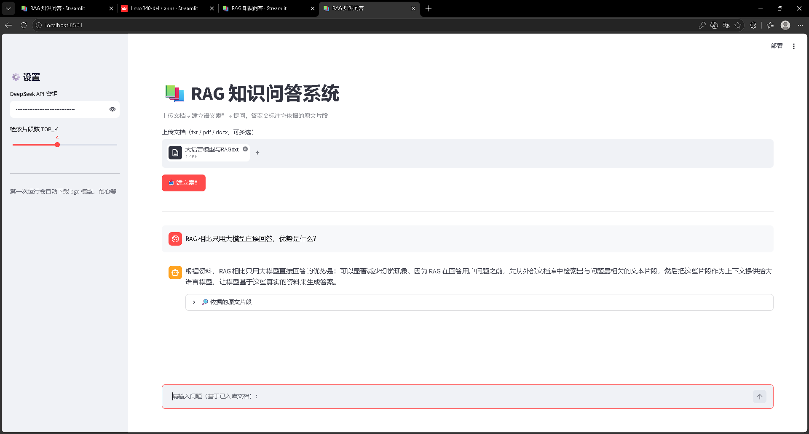

# 📚 RAG 知识问答系统

一个基于 **RAG（检索增强生成）** 的私有知识库问答系统：上传 txt / pdf / docx 文档，自动建立语义索引，提问后由大模型基于检索到的原文片段生成答案，并标注答案依据的原文出处，有效减少「幻觉」。

> **一句话看懂**：RAG = 大模型 + 知识库（检索文档回答）。与 Agent（大模型 + 工具，模型自主决策调用）互补，是大模型落地的两大核心范式之一。

## 这个项目证明什么（面向面试官）

- 能把「大模型 + 知识库」从一个 demo 做成**可交付给企业的服务**：分层重构、34 个单元测试、FastAPI + SSE、Docker 一键部署、SQLite 会话记忆、多租户 + API Key 鉴权。
- 懂**防幻觉**这件事不是嘴上说说，而是落实到 prompt 设计 + 出处标注 + 相似度展示的完整链路。
- 有**半产品化**意识：改一份 `tenants.json` 配置即可部署给新客户，不用改代码——这是「能接企业私活」的直接证据。

## 核心架构



两条链路：**建索引**（左，一次性）把文档切块、向量化、存入 FAISS 并落盘；**查询**（右，每次）检索相似块 → 拼防幻觉 prompt → DeepSeek 生成，多租户层对索引和会话做隔离。

## 技术亮点 / 设计说明

- **分层重构 + 惰性导入**：早期是单文件，现在拆成 `rag/` 包（config / loader / chunker / embedder / indexer / retriever / generator / history / tenants / pipeline，共 10 个模块各司其职）。sentence-transformers、faiss、openai、pdfplumber、python-docx 等重依赖全部做**函数内惰性 import**——`import rag` 不需要装任何重库，纯逻辑模块可脱离重库单独单测。
- **防幻觉落到实现**：`generator.build_prompt` 用固定指令「只根据资料回答，没有就明确说不知道」，答案下方标注依据原文片段 + 相似度，来源可追溯。
- **双持久化**：FAISS 索引落盘（`index.faiss` + `chunks.json`），重启免重新向量化；会话历史存 SQLite，进程/容器重启后多轮记忆依然在。
- **多租户 + 权限（半产品化）**：`tenants.py` 用纯标准库实现 API Key 鉴权（`secrets.compare_digest` 常量时间比对防时序攻击，支持明文/SHA-256 哈希两种存储）+ admin / user 角色；索引按 `kb`、会话按 `tenant_id` 隔离。改 `tenants.json` + 跑 `provision.py` 即可给新客户部署，**不改一行代码**。没配 `tenants.json` 时自动退回单租户无鉴权（向后兼容）。
- **三入口共用一套核心**：命令行 `cli.py`、网页 `app.py`、后端 `api.py` 都调 `rag` 包，逻辑零重复；`api.py` 同时支持 REST 和 SSE 流式。
- **34 个单元测试**：`run_tests.py` 一键跑（不依赖 pytest），覆盖 chunker 边界（修过一个 overlap=0 时因 Python `-0==0` 导致「零重叠」退化成「整块重叠」的真 bug）、多租户鉴权、会话隔离、向后兼容等。

## 功能特性

- 支持 txt / pdf / docx 三种文档格式
- 语义向量检索（bge 中文向量模型 + FAISS），按「意思」匹配，不靠关键词
- 答案防幻觉：只基于检索到的资料回答，资料里没有就明确说不知道
- 答案下方展示「依据的原文片段」及相似度，来源可追溯
- 答案流式输出：逐字呈现，像 ChatGPT 一样
- 多轮对话记忆：同一会话里能接着上一轮追问，历史持久化到 SQLite
- 索引持久化：FAISS 索引存盘，重启免重新向量化
- 命令行版 + 网页版 + API 后端共用同一套核心逻辑（`rag` 包）
- 多租户 + 权限：一套系统可同时服务多个客户，API Key 鉴权、admin/user 角色隔离（半产品化，改 `tenants.json` 即可上线）
- 测试：34 个单测（`run_tests.py` 一键跑，不依赖 pytest）
- 部署：Docker + docker-compose

## 技术栈

- 界面：Streamlit
- 后端：FastAPI（REST + SSE 流式）
- 向量化：sentence-transformers（`BAAI/bge-small-zh-v1.5`）
- 向量检索：FAISS（归一化向量内积 = 余弦相似度）
- 生成：DeepSeek（`deepseek-chat`）
- 文档解析：pdfplumber（PDF）、python-docx（Word）
- 会话记忆：SQLite（标准库，按 租户 + session_id 隔离）
- 测试：标准库 unittest 风格 + 自研 `run_tests.py`
- 部署：Docker + docker-compose

## 本地运行

**方式一：一键启动（推荐）**

Windows 双击 `start.bat`，Linux / macOS 运行 `./start.sh`。脚本会自动：创建 `.env` → 检查/安装依赖 → 让你选「网页版」或「API」。

**方式二：手动**

```bash
cp .env.example .env    # 然后打开 .env，把 sk-xxx 换成你的真实 key
pip install -r requirements.txt
streamlit run app.py    # 网页版
# 或：uvicorn api:app --reload   # API 版
```

API Key 三选一（**不要写进代码**）：

1. 复制 `.env.example` 为 `.env`，填 `DEEPSEEK_API_KEY=sk-你的key`（推荐，代码会自动加载）
2. 或设置环境变量 `DEEPSEEK_API_KEY`
3. 或旧方式：在同目录建 `key.txt`，第一行放你的 key（已被 .gitignore 忽略）

命令行版：`python cli.py`（自动读取 `docs/` 文件夹里的文档建索引后进入交互提问）。

## 部署到 Streamlit Community Cloud

1. 把仓库推送到 GitHub（公开仓库）。
2. [share.streamlit.io](https://share.streamlit.io) → New app → 选本仓库，入口文件填 `app.py`。
3. Settings → Secrets 里加：

```toml
DEEPSEEK_API_KEY = "sk-你的key"
```

4. Deploy，得到公开网址。

## API 服务（FastAPI）

装依赖后启动后端：

```bash
pip install -r requirements-api.txt
uvicorn api:app --reload
```

接口一览：

- `GET  /health`                 健康检查 + 当前是否已建索引
- `POST /build`                  上传文档（multipart）建索引，并存盘
- `POST /load`                   从 `docs/` 文件夹批量建索引
- `POST /query`                  一次性返回 `{"answer", "sources"}`；带 `session_id` 则有记忆
- `POST /query/stream`           SSE 流式返回答案；带 `session_id` 则有记忆
- `DELETE /session/{session_id}`  清空某个会话的历史

多租户鉴权：配置 `tenants.json` 后启用（不配则退回单租户无鉴权）。每个请求带请求头 `X-API-Key: mk-xxx`；`admin` 角色可 `/build`、`/load`、`/session/{id}`，`user` 角色只能 `/query`、`/query/stream`。索引与会话历史按租户隔离。

请求体示例：

```json
{"question": "什么是 RAG？", "top_k": 4, "session_id": "u1"}
```

返回示例：

```json
{
  "answer": "RAG 是检索增强生成……",
  "sources": [
    {"score": 0.82, "file": "大语言模型与RAG.txt", "text": "……"}
  ]
}
```

多轮记忆：同一个 `session_id` 的历史会存进 `chat_history.db`（SQLite），进程/容器重启后依然在。第二次用同一个 `session_id` 问「那第一点呢？」，模型会记得上一轮的上下文。

启动后浏览器打开 `http://127.0.0.1:8000/docs` 可看到自动生成的接口文档。

## Docker 部署

把 API 后端打包成容器，一条命令拉起服务。前置：装好 [Docker Desktop](https://www.docker.com/products/docker-desktop/)。

```bash
# 1) 准备密钥：复制模板并填真实 key
#    Windows：copy .env.example .env
#    然后打开 .env，把 sk-xxx 换成你的真实 key

# 2) 构建并启动
docker compose up --build
```

日常开关：

```bash
docker compose up -d    # 后台启动
docker compose down     # 停止并删除容器
```

启动后浏览器打开 `http://127.0.0.1:8000/docs`，或 `curl http://127.0.0.1:8000/health`。

说明：

- **镜像里不含密钥**：key 通过 `.env`（或 `docker run -e DEEPSEEK_API_KEY=...`）注入；`.env` 和 `key.txt` 都被 `.dockerignore` 排除，不会打进镜像。
- **镜像只装 API 运行时**：Streamlit 网页版和命令行是本地开发工具，不进镜像。
- **三个卷挂载**：bge 模型缓存（`.hf_cache`）、索引（`.rag_index`）、会话历史（`data/`），容器重建后模型不用重新下载、索引不用重新构建。

不用 compose，纯 docker 命令也可以：

```bash
docker build -t rag-api .
docker run -p 8000:8000 -e DEEPSEEK_API_KEY=sk-你的key rag-api
```

## 多租户部署（半产品化）

给企业做私有部署时不用改代码，三步即可：

```bash
# 1) 生成一份含随机 API Key 的多租户配置
python -m rag.tenants > tenants.json

# 2) 编辑 tenants.json：改租户名、把文档放进对应 docs_dir
#    多个租户共享同一知识库时配同一个 kb，只在一个租户里填 docs_dir

# 3) 为每个租户建索引并落盘
python provision.py
```

`tenants.json` 结构（模板见 `tenants.example.json`）：

```json
{
  "tenants": {
    "machinery_admin": {"name": "某机械公司·管理员", "api_key": "mk-xxx", "role": "admin", "kb": "machinery", "docs_dir": "tenants/machinery/docs"},
    "machinery_worker": {"name": "某机械公司·员工", "api_key": "mk-yyy", "role": "user", "kb": "machinery", "docs_dir": null}
  }
}
```

字段说明：`role` 为 `admin` 可建索引/删会话，`user` 只能问答；`kb` 是知识库 id（缺省等于租户 id，多个租户配同一个 `kb` 即共享同一份索引）；`docs_dir` 是建索引的文档目录（相对 `learn_ai/` 或绝对路径）。`tenants.json` 含密钥，已被 `.gitignore` 忽略，不会提交。

启动 API 后，用不同 `X-API-Key` 请求即可访问各自隔离的知识库：

```bash
curl -H "X-API-Key: mk-xxx" http://127.0.0.1:8000/query \
  -H "Content-Type: application/json" \
  -d '{"question": "设备保养周期是多久？"}'
```

## 项目结构

```
learn_ai/
├── rag/                    # 核心包（分层结构）
│   ├── __init__.py         # 对外统一导出
│   ├── config.py           # 配置（环境变量 / .env / key.txt）
│   ├── loader.py           # 文档加载（txt / pdf / docx）
│   ├── chunker.py          # 切块（按句子 + 重叠）
│   ├── embedder.py         # 向量化（bge，懒加载单例）
│   ├── indexer.py          # FAISS 索引（构建 + 落盘持久化）
│   ├── retriever.py        # 检索（top_k 相似块）
│   ├── generator.py        # 生成（DeepSeek + 防幻觉 prompt + 多轮历史）
│   ├── history.py          # 会话记忆（SQLite，按 租户 + session_id）
│   ├── tenants.py          # 多租户注册表 + API Key 鉴权（纯标准库）
│   └── pipeline.py         # 编排（加载→索引→检索→生成）
├── app.py                  # 网页版（Streamlit）
├── cli.py                  # 命令行入口
├── api.py                  # 后端（FastAPI：REST + SSE + 多租户鉴权）
├── provision.py            # 半产品化初始化：按 tenants.json 建索引
├── tenants.example.json    # 多租户配置模板（复制成 tenants.json）
├── start.bat               # Windows 一键启动（双击）
├── start.sh                # Linux/macOS 一键启动
├── tests/                  # 单元测试（34 个）
├── run_tests.py            # 一键跑测试（不依赖 pytest）
├── Dockerfile              # API 后端镜像定义
├── docker-compose.yml      # 一键构建 + 启动
├── .dockerignore           # 不打进镜像的文件（含 key.txt / .env）
├── .env.example            # 密钥模板（复制成 .env 填真实 key）
├── requirements.txt        # 本地运行依赖
├── requirements-api.txt    # 镜像内依赖
├── ocr_pdf_to_word.py      # 扫描版 PDF 的 OCR 转 Word 脚本
├── docs/                   # 示例文档（本地用，已 gitignore）
└── .gitignore              # 忽略 .env / key.txt / .rag_index / chat_history.db 等
```

## 效果截图

建议准备 3 张截图放到仓库根目录：

1. `screenshot.png` — 网页问答页：上传文档后提问，展示「答案 + 依据原文片段 + 相似度」
2. `screenshot-api.png` — FastAPI 接口文档页（`http://127.0.0.1:8000/docs`）
3. `screenshot-multitenant.png` — 多租户演示：两个不同 `X-API-Key` 请求同一接口，返回各自隔离的知识库结果

当前仓库的 `screenshot.png` 是早期版本，建议重新截取替换。


